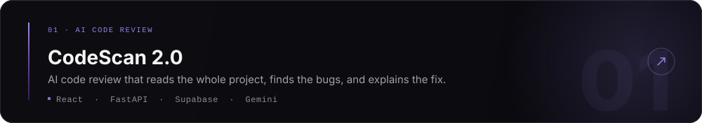
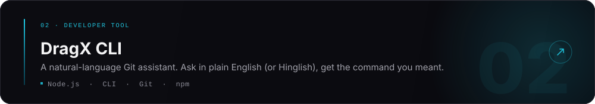
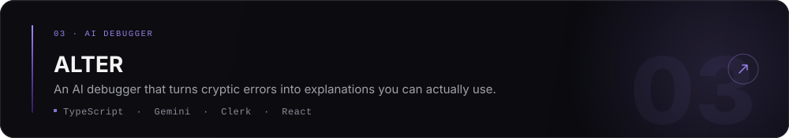
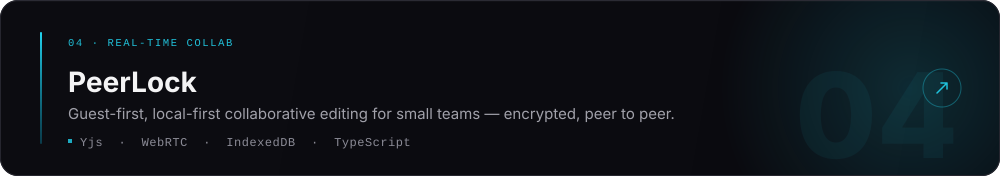
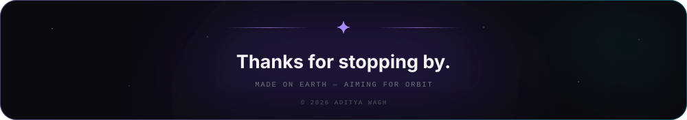

  <picture>
    <source media="(prefers-color-scheme: dark)" srcset="https://raw.githubusercontent.com/DragAditya/DragAditya/main/assets/hero-dark.svg" />
    <source media="(prefers-color-scheme: light)" srcset="https://raw.githubusercontent.com/DragAditya/DragAditya/main/assets/hero-light.svg" />
    
  </picture>

  &nbsp;
  &nbsp;
  &nbsp;
  &nbsp;
  

## 01 · About

I build AI products, developer tools, and interfaces that get out of the way. Most of my work starts as a small *what if* and ends up shipped — from an AI reviewer that reads entire repositories to a CLI that turns plain English into Git commands.

Based in Maharashtra, India. Currently an MCA student, building in public.

- **Now** — building **CodeScan 2.0**, an AI code-review workspace that understands whole projects, not just snippets.
- **Exploring** — AI agents, local-first software, and the craft of making complex things feel simple.
- **Off-screen** — astronomy, anime, and an unreasonable amount of tea.
- **Open to** — collaborations on AI tooling, developer experience, and ambitious side quests.

> Building products that feel simple on the outside and powerful underneath.

## 02 · Toolbox

**Languages** 

**Frontend** 

**Backend & data** 

**Cloud & tools** 

## 03 · Selected Work

A few things I've shipped and still care about.

  

  

  

  

More experiments, prototypes, and half-finished ideas live in my <a href="https://github.com/DragAditya?tab=repositories">repositories</a>.

## 04 · GitHub Signals

  
  

  <picture>
    <source media="(prefers-color-scheme: dark)" srcset="https://raw.githubusercontent.com/DragAditya/DragAditya/output/github-snake-dark.svg" />
    <source media="(prefers-color-scheme: light)" srcset="https://raw.githubusercontent.com/DragAditya/DragAditya/output/github-snake.svg" />
    
  </picture>

## 05 · Now

| **BUILDING** | **LEARNING** | **OFF THE CLOCK** |
| :---: | :---: | :---: |
| **CodeScan 2.0** AI code review, end to end | **AI agents** Tool use, memory, evaluation | **Astronomy** Deep-sky objects, launch windows |
| **DragX CLI** Natural-language Git | **Local-first apps** CRDTs and real-time sync | **Tea** An unreasonable amount |

## 06 · Connect

  

  Maharashtra, India · UTC+5:30 · Open to bold ideas and good problems.

  

